# b0r3d QR for Windows

**b0r3d QR** makes static QR codes and barcodes on your PC, designed the way
[qr.b0r3d.org](https://qr.b0r3d.org) designs them, and reads codes off pictures, folders, the
screen and a webcam. Whatever you type goes straight into the pattern, so a code never expires,
there's no account, and nothing you type or scan is sent anywhere: b0r3d QR never goes online.

Version 0.8, for Windows 10 and 11: one exe of about 4 MB, nothing to install. Made by
[b0r3d.org](https://b0r3d.org).

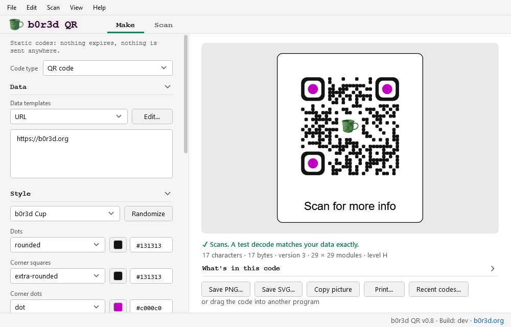

**Not released yet.** 0.8 has everything planned for the first release, 1.0, which comes once
it's been tried out in full.

## Getting it

1. On the [Releases page](https://github.com/still-b0r3d/b0r3d-QR-PC/releases), download
   **b0r3dQR.exe**. It's one file and needs no installing. Put it in a folder of its own (a Tools
   folder, or a USB stick): it keeps its settings in a `b0r3dQR data` folder next to itself.
2. Run it.
   - Your browser may say the file isn't commonly downloaded. Choose **Keep**.
   - Windows may show **"Windows protected your PC"**. Click **More info**, then **Run anyway**.
     It says that about any program it hasn't seen much of yet that isn't code-signed, and b0r3d
     QR isn't (signing costs money every year).
   - To check the file first: its SHA-256 is in `b0r3dQR.exe.sha256`, next to it on the Releases
     page, and PowerShell's `Get-FileHash b0r3dQR.exe` shows the download's. Or
     [build it yourself](#build-it-yourself).

It runs on .NET Framework 4.8, which every up-to-date Windows 10 and 11 already has, and never
asks for admin rights.

## Make a code

Type or paste a link or any text, and the code appears on the right with a line saying whether
it scans. The settings on the left fold out like the website's:

- **Data:** what goes in the code. Above it, the website's **data templates** (text, URL,
  Wi-Fi, contact card, email, phone, SMS, location, event, EPC payment and GS1 product link):
  pick one, or **Edit…**, for a form that writes the text for you, filled from the text
  already there when it's that kind. Under it, the website's checks with a one-click fix
  each: spaces at the ends, a web address without https://, tracking parts in a link.
- **Style:** the presets (Plain, Rounded, Dots, b0r3d Cup, Rukus) and Randomize; the
  shapes and colours of the dots, the corner squares and the corner dots; the background,
  or none; rounded corners.
- **Logo:** choose, paste or drop a picture (an SVG drawing too) onto this section; its size
  and the space around it. The dots behind it are left out, and L or M error correction goes
  up to Q for it, as on the website.
- **Frame:** a caption on any side, the website's frame presets, colours, a background
  picture, border, corners, padding, and the website's 18 caption fonts (built in, so a
  caption looks the same on every PC) or any font on this PC. Emoji in a caption are in
  colour, from Windows' emoji font, as on the website (flat colours where Edge and Chrome
  shade them).
- **Size and print:** error correction (with the website's suggestion for how much text there
  is), a fixed size (QR version), the UTF-8 marker, the quiet zone, the picture size, whole
  pixels per module if you want the sharpest squares, and a print size in mm or inches at
  150, 300 or 600 DPI, with how big each module comes out and from how far it scans.

| Logo and Frame | A caption in one of the website's fonts |
|---|---|
| 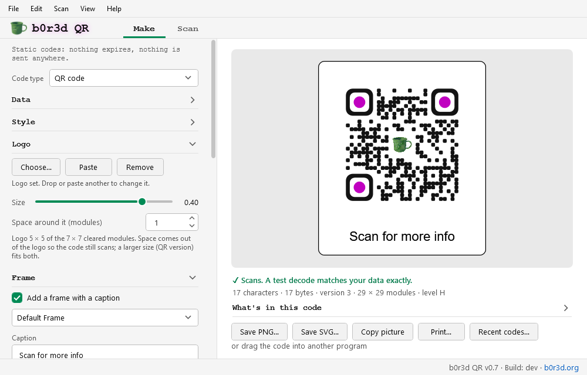 | 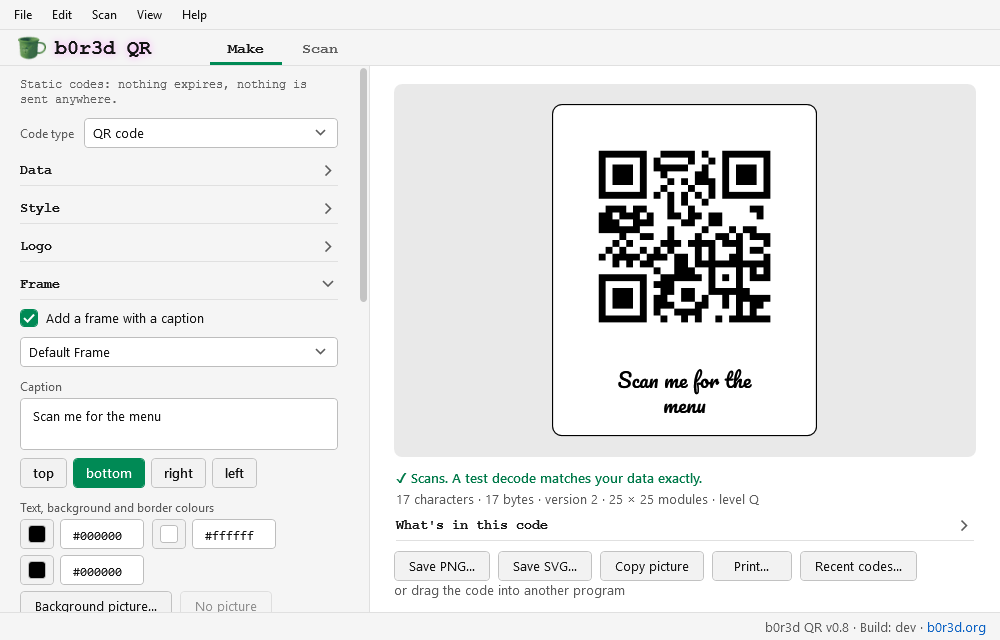 |

Under the code: the scan check, warnings (low contrast, light on dark, see-through, too
little quiet zone) and **What's in this code**: what's stored, the size, the level and how
the text is encoded.

Then **Save PNG…**, **Save SVG…**, **Copy picture** and **Print…** under the code, or the
**File** menu for **JPG**, **PDF** and **text** too (Unicode half or full blocks or ASCII, each
as plain text or Markdown), at the website's sizes or the print size. **Edit** copies it as a
picture, as SVG or as text, or drag the code into another program, or into a folder as a PNG
file.

**File → Save design…** writes the website's own design file (`qr-code-config.json`), and
**Open design…** (or dropping one on the window) opens one saved here or on the website. The
same text and design make the same code, module for module, on both. A logo the website
fetched from a web address isn't drawn here, since b0r3d QR never goes online: save the
picture and choose it under Logo. An SVG logo or frame picture is drawn into every picture as
the website draws it, but for an SVG's patterns, masks, filters and markers, which are left out.
Emoji in its text are in colour, as in a caption. One too big or too deeply nested to draw
safely is refused, with the reason.

A data template's form, here a contact card with its example in it:

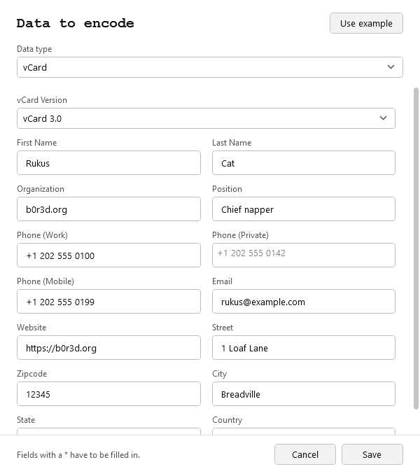

**Recent codes…** (under the code, or **File → Recent codes…**) lists the last 20 codes you
saved, copied or dragged out, newest first, to open again (design and text) or delete; Clear
all deletes the lot. Making the same text again replaces its old entry, and a Wi-Fi network
with its password is listed without a picture. To stop codes being added, untick **Add codes I
save, copy or drag out** there.

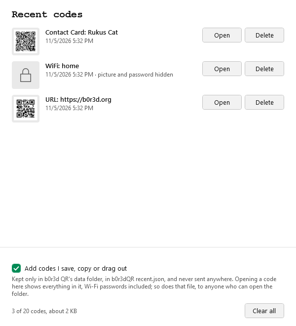

## Make a barcode

**Code type**, above the settings, switches from a QR code to one of the website's other
barcodes: Data Matrix, GS1 DataMatrix, Aztec and PDF417; EAN-13, EAN-8, UPC-A, UPC-E and
ISBN; Code 128, GS1-128, ITF-14 and Code 39. The website has zint make them, so b0r3d QR
follows zint's rules: a barcode comes out the same here as there, down to the SVG file.

- **Data:** what goes in it, with the website's hint and example for each type. Check digits
  are added for you, or checked when you type them; GS1 data goes in round brackets, like
  `(01)09506000134352(10)ABC123`, and is checked as zint checks it. When something can't be
  made, the website's message says why.
- **Barcode settings:** the text under the bars, the bar height and the quiet zones (for
  barcodes with bars), a rectangular Data Matrix, the colours or a see-through background,
  the size in pixels per module, and a print size in mm or inches at 150, 300 or 600 DPI,
  whole pixels for every bar.

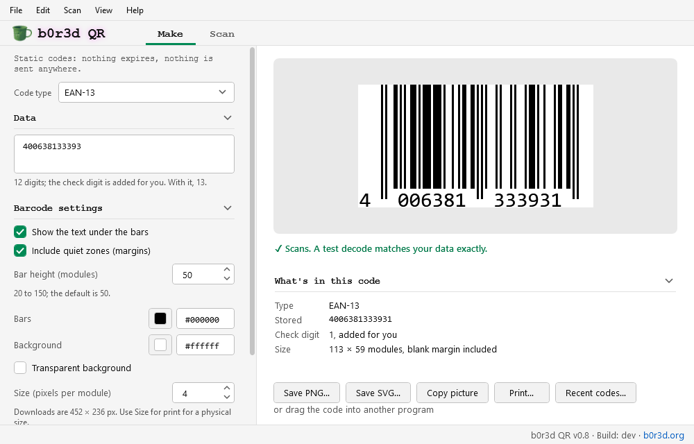

The scan check, warnings, What's in this code, the files (PNG, JPG, SVG and PDF), copying,
dragging, printing and Recent codes work for barcodes as for QR codes. Each type keeps its own
text while b0r3d QR is open, and the barcode settings are kept for next time.

## Many codes at once

**File → Batch export…** (Ctrl+B), or dropping a CSV file on the Make tab, makes a file for
every row of a CSV: QR codes in the Make tab's design, or the barcode type showing in its
settings. The CSV is the website's: for QR codes, a first row naming the columns, then each
code's text, a frame caption and a file name (a frameFontFamily column sets the caption's
font), or a file of contacts with firstName and lastName columns, each row made into a contact
card; for barcodes, the code and a file name, with or without a first row naming them.
**Save an example…** writes one to start from.

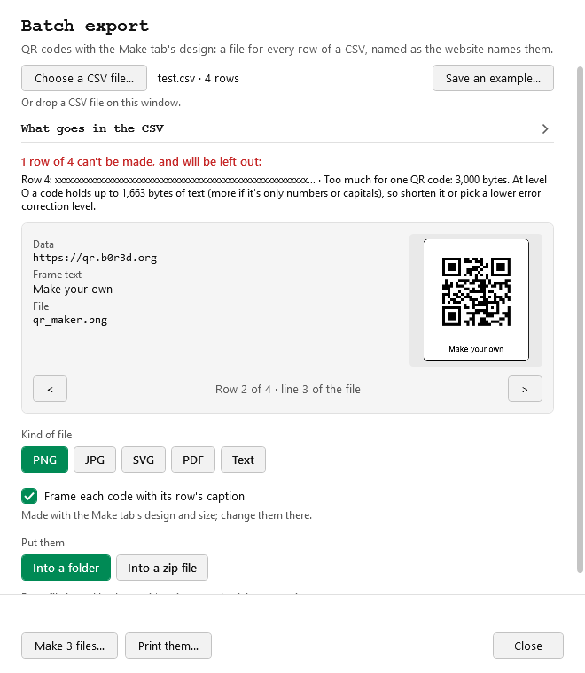

The window lists the rows that can't be made and why before anything is written, and shows
each row's code in turn. Choose PNG, JPG, SVG, PDF or text, and a folder or a zip file; files
already in the folder are asked about once (number the new ones, replace them or skip them).
Every file is read back once it's written and scanned. A row that fails while it's being made is
listed with why, and the others are still made. The files are named as the website names
them: the CSV's file name, else the caption, else something from the code's text (text files:
the CSV's file name, else qr-0, qr-1 and so on).

## Print

**Print…** under the code, or **File → Print…** (Ctrl+P), prints the code at its exact size,
the print size set on the Make tab (its picture's size without one): alone in the middle of the
page, or a sheet of copies with a caption under each code and cut marks at the corners.
**Print them…** in Batch export prints a batch's codes on sheets, each with its file name, or
one a page.

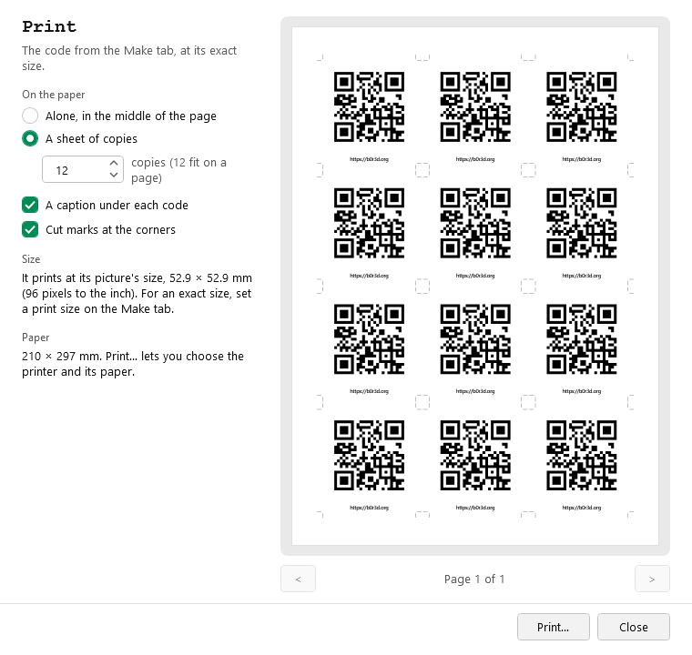

The window shows each page before Windows' Print dialog, where you choose the printer and its
paper. The codes are printed as shapes, as sharp as the printer prints; one bigger than the
paper is printed smaller, and the window says so.

## Read codes

The **Scan** tab reads QR codes, Data Matrix, Aztec, PDF417 and the common barcodes (EAN and
UPC product numbers, Code 128, Code 39, Code 93, ITF, Codabar and GS1 DataBar), as many as
there are in a picture:

- **Scan the screen** (Scan menu, Ctrl+Shift+R): b0r3d QR steps aside and every screen
  freezes. Drag a box around a code, click a screen to read all of it, or press Enter to
  read every screen; Esc cancels.
- **Scan with the camera** (Scan menu, Ctrl+Shift+A): your webcam's picture, with the
  website's aiming frame. The first code it sees goes to the Scan tab and the camera turns off
  at once; Esc or **Cancel** turns it off without one. With more than one camera, choose which
  from the list. Windows has to let desktop apps use the camera:
  Settings > Privacy & security > Camera (on Windows 10, Settings > Privacy > Camera).
- **Open picture…** (Ctrl+O), Ctrl+V with a picture copied (or **Paste picture**,
  Ctrl+Shift+V), or drop pictures anywhere on the window: PNG, JPEG, BMP, GIF and TIFF
  (every page), and WebP or HEIC where Windows can open them. For a PDF, open it and scan
  the screen.
- **Scan a folder…** (Ctrl+Shift+O) reads every picture in a folder (not the folders inside
  it) and gives each one a line, so a batch can be checked: its codes, or "No code found",
  or "Couldn't open" and why. Pictures that are only online (OneDrive and the like) are
  left alone rather than downloaded.

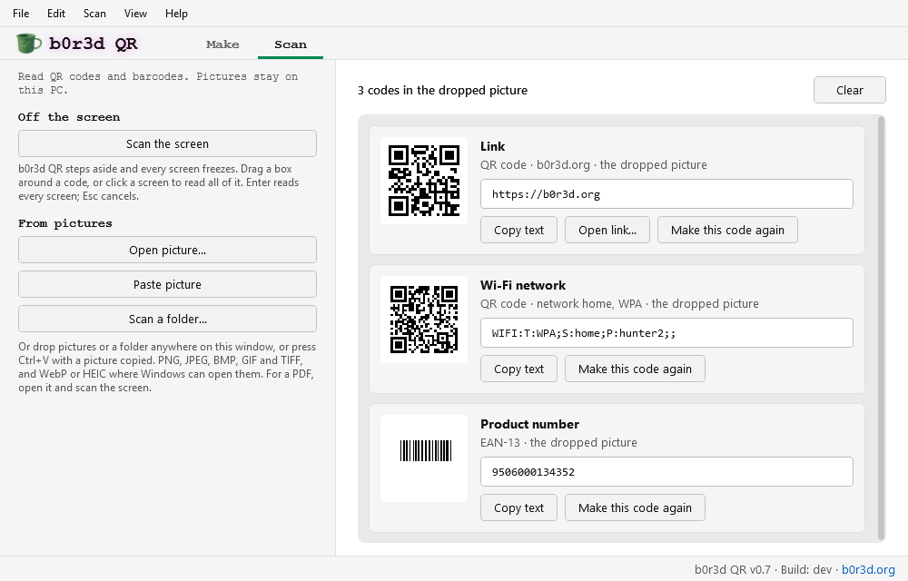

Esc or **Cancel** stops a scan. Each code found shows what it is (a link, a Wi-Fi network, a
contact, a product number…), its type and where it was, with its whole text in a box under
that. The line under its name leaves out Wi-Fi passwords and sign-in secrets. **Copy text**
copies the text, **Open link…** asks first and says if anything about the link looks off
(no encryption, a numbered address, letters from other alphabets that look like another
site's), and **Make this code again** puts a plain QR code's exact text on the Make tab
with the same error correction, or a barcode's as the same type of barcode. GS1 data is
shown in round brackets, as the Make tab takes it. A letter carrying more than 100 accents or
other marks is shown with only its first 100, here and everywhere else in b0r3d QR, as Windows
can't lay out many more: **Copy text** still copies the whole text, and **Make this code
again** says the rest were left out.

| Scanning the screen | A folder checked as a batch |
|---|---|
| 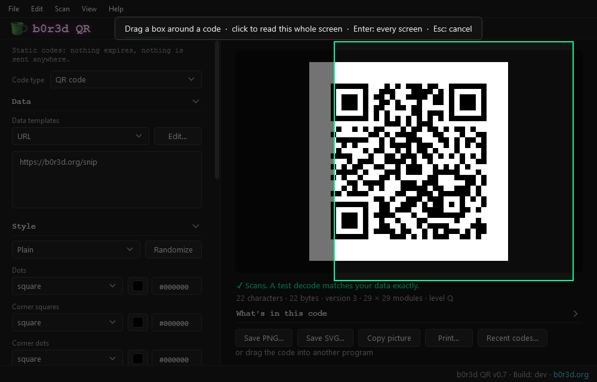 | 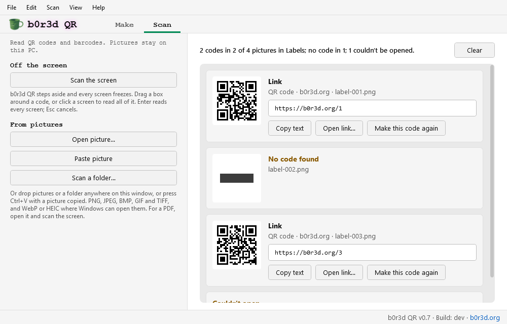 |

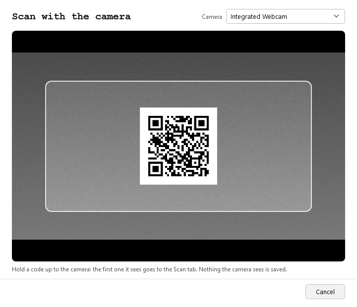

## Light or dark

**View → Look** follows Windows' light or dark setting, or stays light or dark. The code itself
is never tinted.

| Light | Dark |
|---|---|
|  | 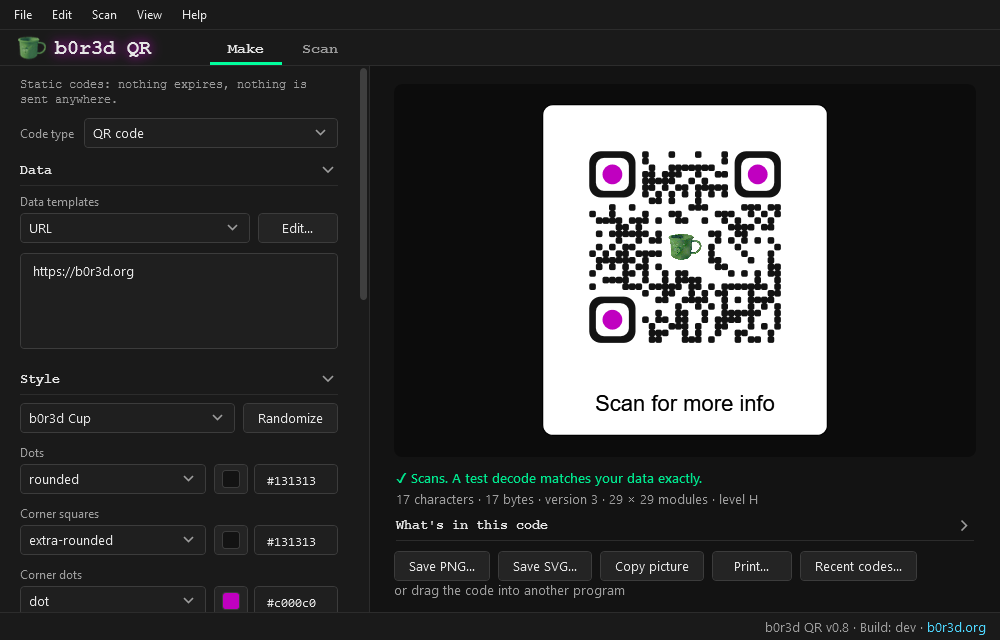 |

## Settings

b0r3d QR keeps its settings in `b0r3dQR.ini`, the design you last had in
`b0r3dQR design.json` (the website's format, without the code's text), and Recent codes in
`b0r3dQR recent.json`, in a `b0r3dQR data` folder next to the exe. It writes nothing anywhere
else itself: not in AppData, not in the registry. To keep them somewhere else, start it with:

```
b0r3dQR.exe --data "D:\Somewhere\b0r3dQR settings"
```

That folder can hold other things too: b0r3d QR only ever touches its own `b0r3dQR.ini`,
`b0r3dQR design.json`, `b0r3dQR recent.json` and `b0r3dQR drag` folder there.

A code's text is only kept in Recent codes: the codes you saved, copied or dragged out, while
it's on. That file is plain text (Wi-Fi passwords included), so anyone who can open the data
folder can read it; turn Recent codes off and Clear all if that matters. A frame's caption is
part of the design, so it's kept in `b0r3dQR design.json`. A code you drag out waits as a PNG
in the `b0r3dQR drag` folder until b0r3d QR closes (or starts again, if it was stopped), so the
program you drop it on can take it. Nothing you scan is kept: pictures of the screen, the
camera's pictures and the codes found only ever live in memory. If the exe's
folder can't be written to, it says so as soon as it starts and keeps working without saving
settings. Run straight out of a zip, an email attachment or a download folder inside AppData,
it keeps nothing there either.

Windows keeps a few records of its own about any program you run: the Open and Save
dialogs remember the last folder you used, and Explorer notes which programs you've
started. b0r3d QR asks Windows not to add the files you open or save to your Recent items,
and a copied code or text never goes to Windows' cloud clipboard. After a scan with the
camera, Windows lists b0r3d QR and the time under Settings > Privacy & security > Camera, as
it does for every program that uses one.

## What it doesn't do

- It never goes online: there's no network code in it at all, and a test checks the exe for
  any. A link opens in your browser only when you click it: b0r3d.org, the Releases page, or a
  scanned code's link (after a question).
- It never turns the camera on by itself: only **Scan with the camera** does, and the camera
  turns off as soon as a code is read or the window closes.
- It never loads a DLL from the folder it's in: the Windows DLLs it calls come from System32
  only.
- It doesn't keep what you scan, or a code's text outside Recent codes (and a dragged code's
  picture until it closes).
- No installer, no admin rights, nothing in AppData or the registry.

## Newer versions

**Help → Check for a new version** opens the Releases page in your browser; b0r3d QR never
looks by itself. To update, put the new b0r3dQR.exe in place of the old one: the
`b0r3dQR data` folder next to it keeps your settings and Recent codes.

## Removing it

Delete b0r3dQR.exe and its `b0r3dQR data` folder. There's nothing else to remove. (With
`--data`, delete just b0r3d QR's own files in that folder, the four named under Settings.)

## Build it yourself

Building needs the [.NET 10 SDK](https://dotnet.microsoft.com/download); running the result
needs only Windows. Double-click `build.cmd`, or run `build.cmd test` to build and run the
tests too. The program is `bin\b0r3dQR.exe`. Every release is built the same way on GitHub's own
machines, which stamp it with the commit it was built from (`v0.8 · Build: abc1234` in the
window's corner and in Help → About); your own build says `Build: dev`. The SHA-256 next to each
download is for checking that download: your own build won't match it byte for byte.

`bin\tests\b0r3dQRTests.exe --shots <folder>` draws every window offscreen (nothing shows on the
screen), in light and dark, into PNG files; the pictures here are some of them, under the same
names in `docs\images`. What changed in each version is in [CHANGELOG.md](CHANGELOG.md).

## License

MIT + Commons Clause: free to use, change and share, but not to sell. See
[LICENSE](LICENSE). b0r3d QR includes [ZXing.Net](https://github.com/micjahn/ZXing.Net)
(Apache-2.0). To come out as qr.b0r3d.org makes them, its barcodes follow
[zint](https://www.zint.org.uk) 2.16.0 (BSD-3-Clause), and its QR codes follow
[qrcode-generator](https://github.com/kazuhikoarase/qrcode-generator) (MIT) and, with the UTF-8
marker, zint, whose QR modes come from [Project Nayuki](https://www.nayuki.io/page/qr-code-generator-library)'s
library (MIT). The caption fonts are the website's 18 from [Fontsource](https://fontsource.org),
each under the SIL Open Font License 1.1; its character tables are made from Unicode's data
(Unicode License V3), and the way it takes a caption's letters and accents from a font follows
[HarfBuzz](https://harfbuzz.github.io) (Old MIT). Everyone's notices are in
[THIRD-PARTY-NOTICES.txt](THIRD-PARTY-NOTICES.txt).

QR Code is a registered trademark of DENSO WAVE INCORPORATED.

---

Made by [b0r3d.org](https://b0r3d.org).
